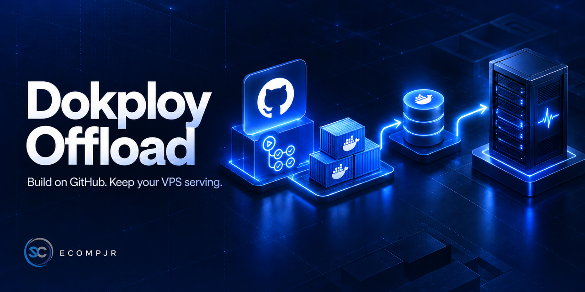
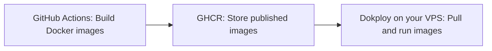

<h1 align="center">Dokploy Offload</h1>

<p align="center">
  <strong>Dokploy Offload ※ Build on GitHub • Keep your VPS serving.</strong>
</p>

<p align="center">
  
</p>

<p align="center">
  <a href="#quick-start">Quick start</a> ·
  <a href="#examples-by-application-layout">Examples</a> ·
  <a href="#inputs">Inputs</a> ·
  <a href="#published-images-and-deployment-behavior">Deployment behavior</a> ·
  <a href="LICENSE">BSD 3-Clause</a>
</p>

---

Dokploy Offload moves Docker builds from your production VPS to GitHub Actions. It builds your application images, publishes them to GitHub Container Registry (GHCR), and triggers Dokploy to pull and run them. Give your server more room for live traffic by keeping dependency installation, compilation, and asset bundling on GitHub runners.

Built for developers and small teams deploying with Dokploy, especially when several applications share a resource-constrained VPS.

| More room for live traffic | A fit for your application |
| --- | --- |
| Move CPU, memory, and disk-intensive builds off your VPS. | Deploy one fullstack image, a backend, a frontend, or both services. |
| **Publish before deploying** | **Use your existing workflow** |
| Call the webhook only after every selected image publishes successfully. | Use Dockerfiles, GitHub Actions, GHCR, and a Dokploy webhook. No Dokploy API key or SSH access required. |

### Build → Publish → Deploy



Select `fullstack`, `both` (default), `back`, or `frontend`. `backend` remains an alias for `back`. The action is used as `ecompjr/dokploy-action@release`; its repository path is unchanged.

See [PRODUCT.md](PRODUCT.md) for the product direction and [AGENTS.md](AGENTS.md) for repository contribution guidance.

## Why build in GitHub Actions?

Building application images can consume significant CPU, memory, and disk space while installing dependencies, compiling code, and bundling frontend assets. Running those builds on the same VPS that serves your applications makes them compete for resources, which can slow live traffic or exhaust memory on smaller servers.

This action moves that work to GitHub Actions runners. Each runner builds the selected Docker images and pushes them to GHCR. Once every selected image is published, the action calls the Dokploy webhook so the VPS can pull and run the finished images.

The VPS still needs resources to download images and start containers, but it no longer needs to compile your application during deployment. This reduces deployment load and leaves more capacity for running applications. Configure Dokploy to use the published images, as described below, so builds stay on the GitHub runners.

## Quick start

> [!IMPORTANT]
> The checked-out calling project must contain `compose.dokploy.yml` or `compose.dokploy.yaml` at its root. The action checks for a file before building or publishing any images and fails if neither is present.

### 1. Prepare your application and Dokploy

1. Each selected service needs a Dockerfile. For `fullstack`, the defaults are `Dockerfile` and the repository root as context. Separate services default to `backend/Dockerfile` and `frontend/Dockerfile`, with their respective directories as build contexts. Application compilation belongs in the Dockerfile, so the server only pulls the finished image.
2. Configure Dokploy to pull the published images. For separate applications, select Docker as the source and use `ghcr.io/owner/repository-backend:latest` and/or `ghcr.io/owner/repository-frontend:latest`. For a shared Compose deployment, reference those images in Compose; do not configure server-side builds. Enable Auto Deploy and copy the deployment webhook URL.
3. Store the URL as the Actions secret `DOKPLOY_WEBHOOK_URL`, as shown in [examples/deploy.yml](examples/deploy.yml). The URL must point to a deployment that manages every selected service; the action cannot change which services a Compose webhook deploys.
4. Copy the example into your application's `.github/workflows/deploy.yml`. Use `ecompjr/dokploy-action@release` for the latest successful build of `main`, or pin a commit from the `release` branch. The branch becomes available after the first successful CI publication.

### 2. Add the action to your workflow

```yaml
permissions:
  contents: read
  packages: write

# Within a job running on ubuntu-latest:
steps:
  - uses: actions/checkout@v5
  - uses: ecompjr/dokploy-action@release
    with:
      github-token: ${{ secrets.GITHUB_TOKEN }}
      services: both
      webhook-url: ${{ secrets.DOKPLOY_WEBHOOK_URL }}
```

### 3. Allow registry access

No Dokploy API key, application ID, SSH access, or additional publishing token is required. GitHub supplies `GITHUB_TOKEN`. Dokploy needs registry credentials to pull private GHCR packages; alternatively make the packages public. Existing packages must grant the calling repository Actions write access. Package visibility is managed in GitHub, not by this action.

## Inputs

| Input                                        | Default                                      | Purpose                                                                |
| -------------------------------------------- | -------------------------------------------- | ---------------------------------------------------------------------- |
| `github-token`                               | required                                     | `${{ secrets.GITHUB_TOKEN }}` with `packages: write`                   |
| `services`                                   | `both`                                       | `fullstack`, `both`, `back`, or `frontend`; `backend` is also accepted |
| `webhook-url`                                | required                                     | Deployment webhook; called once after all selected images publish      |
| `image-prefix`                               | calling repository, lowercase                | `owner/name`, without registry or tag                                  |
| `tag`                                        | `latest`                                     | Deployment tag; must match Dokploy configuration                       |
| `platforms`                                  | `linux/amd64`                                | Docker platform(s), e.g. `linux/amd64,linux/arm64`                     |
| `fullstack-context`                          | `.`                                          | Build context for the single application                               |
| `fullstack-file`                             | `Dockerfile`                                 | Dockerfile for the single application                                  |
| `fullstack-target`                           | empty                                        | Optional build stage                                                   |
| `fullstack-build-args`                       | empty                                        | Newline-separated `KEY=value` build arguments                          |
| `fullstack-secrets`                          | empty                                        | Newline-separated BuildKit `key=value` secrets                         |
| `backend-context` / `frontend-context`       | `backend` / `frontend`                       | Build context                                                          |
| `backend-file` / `frontend-file`             | `backend/Dockerfile` / `frontend/Dockerfile` | Dockerfile path relative to checkout                                   |
| `backend-target` / `frontend-target`         | empty                                        | Optional build stage                                                   |
| `backend-build-args` / `frontend-build-args` | empty                                        | Newline-separated `KEY=value` build arguments                          |
| `backend-secrets` / `frontend-secrets`       | empty                                        | Newline-separated BuildKit `key=value` secrets                         |

Frontend build arguments are typically embedded in browser bundles. Use BuildKit secrets for confidential build credentials. Runtime environment variables belong in Dokploy.

## Published images and deployment behavior

For `EcompJr/example`, both mode publishes `ghcr.io/ecompjr/example-backend:latest` and `ghcr.io/ecompjr/example-frontend:latest`, plus `sha-<full-commit-sha>` tags. `fullstack` publishes only `ghcr.io/ecompjr/example-fullstack:latest`, also with a commit tag. `back` publishes only the backend image; `frontend` publishes only the frontend image. Outputs are `fullstack-image`, `backend-image`, `frontend-image`, and the corresponding `fullstack-digest`, `backend-digest`, and `frontend-digest`; unselected services have empty image outputs.

All selected images must publish successfully before any webhook runs. The single webhook is called once, and a failed request fails the action. Requests use a GitHub push payload with a 120-second timeout. Only HTTP 2xx is accepted; redirects are rejected because Dokploy may use them for validation failures.

> [!NOTE]
> An accepted webhook means a deployment was requested. It does not confirm application health.

Publishing two images is not atomic. A failed second build can leave the first image's mutable tag updated, but the webhook is only called after all selected builds succeed. Serialize workflows that publish the same tags, as in the example. Use a different tag and concurrency group for each environment. Do not call this action for untrusted pull requests.

Use a GitHub-hosted Ubuntu runner (Node.js 22+, Docker, and Bash). The caller must check out its application first. Buildx and GitHub Actions build caching are configured automatically; QEMU is configured for non-default platforms.

## Examples by application layout

| Mode        | Layout and framework examples                                                                                                                 | Workflow                                   | Compose                                                      |
| ----------- | --------------------------------------------------------------------------------------------------------------------------------------------- | ------------------------------------------ | ------------------------------------------------------------ |
| `fullstack` | One application serves API and pages: FastAPI with Jinja2 or a compiled SPA, Django with templates, Laravel, or a Next.js app with API routes | [Fullstack](examples/deploy-fullstack.yml) | [Single application](examples/compose-fullstack.dokploy.yml) |
| `both`      | Two images: FastAPI + React served by nginx, Django REST + Vue served by nginx, or Express + Angular served by nginx                          | [Both](examples/deploy-both.yml)           | [Backend and frontend](examples/compose-both.dokploy.yml)    |
| `back`      | API only: FastAPI, Django REST Framework, Express, or Spring Boot                                                                             | [Backend](examples/deploy-back.yml)        | [Backend only](examples/compose-back.dokploy.yml)            |
| `frontend`  | UI only: React/Vite, Vue, Angular, or a static Astro site served by nginx                                                                     | [Frontend](examples/deploy-frontend.yml)   | [Frontend only](examples/compose-frontend.dokploy.yml)       |

Copy the chosen workflow into `.github/workflows/deploy.yml` and its Compose file to `compose.dokploy.yml` at the project root. Replace the image owner/repository, set the webhook secret, and adjust ports to match your Dockerfiles. Every mode still requires the root Compose file. These examples use `latest`; changing `tag` also requires updating the Compose image tags.

For a FastAPI fullstack app, the root Dockerfile must include its templates/static files or build and copy the SPA assets into the Python image. FastAPI serves both the API and pages on the same port. A Next.js fullstack app instead needs a Dockerfile that builds and runs the Node server; set its Compose port to the server's port, commonly `3000`.

In `both` mode, the frontend Dockerfile builds the browser bundle and copies it into nginx. For the example's `/api` URL, configure nginx to proxy `/api` to `http://backend:8000`, preserving or stripping the prefix according to the backend's routes. Alternatively set a public API URL and configure backend CORS. Browser code cannot reach the Compose hostname `backend` directly. Adjust the backend port for other frameworks.

For an API at the repository root, use `services: back` with `backend-context: .` and `backend-file: Dockerfile`, as in the backend workflow. For a frontend at the root, use the corresponding `frontend-*` inputs. A monorepo can keep the default `backend` and `frontend` directories. Optional build stages, arguments, and secrets are available independently for all three image types.

## Development

TypeScript source lives in `src/*.mts`, using strict type checking and small dependency interfaces. `bun run build` compiles it to the ignored `scripts/*.mjs` directory. Edit and commit only the TypeScript source; generated JavaScript is published by CI.

The JavaScript entry point, `scripts/deploy.mjs`, keeps the `plan` and `deploy` commands and the exported `configuration`, `plan`, and `deploy` functions. Its implementation is split by responsibility:

- `DeploymentConfiguration` validates service selection and the webhook URL.
- `ComposeProject` checks the calling project's compose file.
- `ImagePlanner` validates image settings and produces action outputs.
- `DokployDeployer` sends the push webhook and handles its response safely.

Constructors accept dependencies as small objects: configuration exposes `parse(env)`, the project exposes `validate(workspace)`, and the logger exposes `log(message)`. The filesystem `stat` function and HTTP `request` function can also be replaced. This keeps planning and delivery testable without disk or network access and allows alternative implementations without changing their consumers.

Use Bun 1.3.12. Run `bun install --frozen-lockfile`, then `bun run test` to build and run the tests. Use `bun run typecheck` for a check without emitting JavaScript. CI also runs the compiled tests on Node.js 22 to verify the customer runtime. The build uses [TypeScript’s NodeNext module mode](https://www.typescriptlang.org/tsconfig/module.html). CI also validates workflow/action syntax with actionlint. Real image publication and Dokploy deployment require a calling repository, package permissions, and a live webhook.

References: [Dokploy registry setup](https://docs.dokploy.com/docs/core/providers), [Dokploy auto-deploy](https://docs.dokploy.com/docs/core/auto-deploy).

## Automatic publication

Each push to `main` installs dependencies from `bun.lock` using [Bun’s frozen lockfile mode](https://bun.sh/docs/pm/cli/install), then runs tests and actionlint. After validation succeeds, CI builds the TypeScript and pushes a new commit containing the repository files and compiled `scripts/` to the `release` branch. That branch keeps its own build history; each commit message records the source SHA. Publication is serialized, and outdated runs skip publication when `main` has advanced.

Customers use `ecompjr/dokploy-action@release` or a specific commit from that branch. Their CI executes the compiled JavaScript directly, without installing this action's dependencies or compiling TypeScript. `@main` contains source only and is not a runnable distribution. Version tags such as `v1` are not created or moved automatically.

The publishing job uses the built-in `GITHUB_TOKEN` with `contents: write`; no extra secret is needed. Repository rules must allow that token to push to `release`. Pushes made with this token do not start recursive workflow runs ([GitHub documentation](https://docs.github.com/en/actions/how-tos/write-workflows/choose-when-workflows-run/trigger-a-workflow)). A failed build or validation leaves the published branch unchanged.

## License

Dokploy Offload is licensed under the [BSD 3-Clause License](LICENSE). Copyright (c) 2026, EcompJr - UEFS. See the license for redistribution conditions and the warranty disclaimer.
