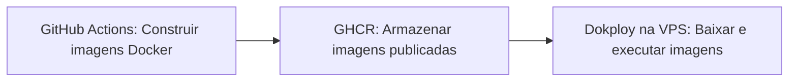

<p align="center">
  
</p>

<h1 align="center">Dokploy Offload</h1>

<p align="center">
  <strong>Dokploy Offload ※ Build on GitHub • Keep your VPS serving.</strong>
</p>

<p align="center">
  <a href="README.md" lang="en">English</a> ·
  <strong>Português brasileiro</strong>
</p>

<p align="center">
  <a href="#início-rápido">Início rápido</a> ·
  <a href="#exemplos-por-estrutura-da-aplicação">Exemplos</a> ·
  <a href="#entradas">Entradas</a> ·
  <a href="#imagens-publicadas-e-comportamento-da-implantação">Comportamento da implantação</a> ·
  <a href="LICENSE">BSD 3-Clause</a>
</p>

---

O Dokploy Offload transfere os builds Docker da sua VPS de produção para o GitHub Actions. Ele constrói as imagens da aplicação, publica no GitHub Container Registry (GHCR) e aciona o Dokploy para baixar e executar essas imagens. Deixe mais recursos do servidor disponíveis para atender às requisições, mantendo a instalação de dependências, a compilação e o empacotamento de arquivos nos runners do GitHub.

Feito para desenvolvedores e pequenas equipes que usam Dokploy, especialmente quando várias aplicações compartilham uma VPS com recursos limitados.

| Mais recursos para atender às requisições | Flexibilidade para sua aplicação |
| --- | --- |
| Transfira os builds que consomem CPU, memória e disco para fora da VPS. | Implante uma imagem fullstack, um backend, um frontend ou os dois serviços. |
| **Publique antes de implantar** | **Use seu fluxo de trabalho atual** |
| Acione o webhook somente após a publicação bem-sucedida de todas as imagens selecionadas. | Use Dockerfiles, GitHub Actions, GHCR e um webhook do Dokploy. Sem necessidade de chave de API do Dokploy ou acesso SSH. |

### Construir → Publicar → Implantar



Selecione `fullstack`, `both` (padrão), `back` ou `frontend`. `backend` continua sendo um alias de `back`. Use a action como `ecompjr/dokploy-offload-action@release`.

Consulte [PRODUCT.md](PRODUCT.md) para conhecer a direção do produto e [AGENTS.md](AGENTS.md) para as orientações de contribuição ao repositório.

## Por que construir no GitHub Actions?

Construir imagens de aplicações pode consumir bastante CPU, memória e espaço em disco durante a instalação de dependências, a compilação e o empacotamento do frontend. Quando esses builds são executados na mesma VPS que atende às aplicações, eles disputam recursos, o que pode tornar as requisições mais lentas ou esgotar a memória em servidores menores.

Esta action transfere esse trabalho para os runners do GitHub Actions. O runner constrói as imagens Docker selecionadas e as envia ao GHCR. Após a publicação de todas as imagens selecionadas, a action chama o webhook do Dokploy para que a VPS baixe e execute as imagens prontas.

A VPS ainda precisa de recursos para baixar imagens e iniciar contêineres, mas deixa de compilar a aplicação durante a implantação. Isso reduz a carga da implantação e deixa mais capacidade disponível para as aplicações em execução. Configure o Dokploy para usar as imagens publicadas, conforme descrito abaixo, para manter os builds nos runners do GitHub.

## Início rápido

> [!IMPORTANT]
> O projeto que usa a action deve estar disponível após o checkout e conter `compose.dokploy.yml` ou `compose.dokploy.yaml` na raiz. A action verifica a existência de um desses arquivos antes de construir ou publicar imagens e falha se nenhum estiver presente.

### 1. Prepare sua aplicação e o Dokploy

1. Cada serviço selecionado precisa de um Dockerfile. Para `fullstack`, os padrões são `Dockerfile` e a raiz do repositório como contexto. Serviços separados usam, por padrão, `backend/Dockerfile` e `frontend/Dockerfile`, com os respectivos diretórios como contextos de build. A compilação da aplicação deve acontecer no Dockerfile, para que o servidor apenas baixe a imagem pronta.
2. Configure o Dokploy para baixar as imagens publicadas. Para aplicações separadas, selecione Docker como fonte e use `ghcr.io/owner/repository-backend:latest` e/ou `ghcr.io/owner/repository-frontend:latest`. Para uma implantação compartilhada com Compose, referencie essas imagens no Compose; não configure builds no servidor. Ative o Auto Deploy e copie a URL do webhook de implantação.
3. Salve a URL no secret do Actions `DOKPLOY_WEBHOOK_URL`, como em [examples/deploy.yml](examples/deploy.yml). A URL deve apontar para uma implantação que gerencie todos os serviços selecionados; a action não altera quais serviços um webhook do Compose implanta.
4. Copie o exemplo para `.github/workflows/deploy.yml` na sua aplicação. Use `ecompjr/dokploy-offload-action@release` para o último build bem-sucedido de `main`, ou fixe um commit da branch `release`. Essa branch fica disponível após a primeira publicação bem-sucedida pela CI.

### 2. Adicione a action ao workflow

```yaml
permissions:
  contents: read
  packages: write

# Dentro de um job executado em ubuntu-latest:
steps:
  - uses: actions/checkout@v5
  - uses: ecompjr/dokploy-offload-action@release
    with:
      github-token: ${{ secrets.GITHUB_TOKEN }}
      services: both
      webhook-url: ${{ secrets.DOKPLOY_WEBHOOK_URL }}
```

### 3. Permita o acesso ao registro

Não é necessário fornecer chave de API do Dokploy, ID de aplicação, acesso SSH ou token adicional de publicação. O GitHub fornece `GITHUB_TOKEN`. O Dokploy precisa de credenciais do registro para baixar pacotes privados do GHCR; como alternativa, torne os pacotes públicos. Pacotes existentes devem conceder ao Actions do repositório que usa a action permissão de escrita. A visibilidade dos pacotes é gerenciada no GitHub, não por esta action.

## Entradas

| Entrada | Padrão | Finalidade |
| --- | --- | --- |
| `github-token` | obrigatório | `${{ secrets.GITHUB_TOKEN }}` com `packages: write` |
| `services` | `both` | `fullstack`, `both`, `back` ou `frontend`; `backend` também é aceito |
| `webhook-url` | obrigatório | Webhook de implantação; chamado uma vez após a publicação de todas as imagens selecionadas |
| `image-prefix` | repositório que usa a action, em minúsculas | `owner/name`, sem registro ou tag |
| `tag` | `latest` | Tag de implantação; deve corresponder à configuração do Dokploy |
| `platforms` | `linux/amd64` | Plataformas Docker, por exemplo `linux/amd64,linux/arm64` |
| `fullstack-context` | `.` | Contexto de build da aplicação única |
| `fullstack-file` | `Dockerfile` | Dockerfile da aplicação única |
| `fullstack-target` | vazio | Estágio de build opcional |
| `fullstack-build-args` | vazio | Argumentos de build `KEY=value`, separados por quebras de linha |
| `fullstack-secrets` | vazio | Secrets do BuildKit `key=value`, separados por quebras de linha |
| `backend-context` / `frontend-context` | `backend` / `frontend` | Contexto de build |
| `backend-file` / `frontend-file` | `backend/Dockerfile` / `frontend/Dockerfile` | Caminho do Dockerfile relativo ao checkout |
| `backend-target` / `frontend-target` | vazio | Estágio de build opcional |
| `backend-build-args` / `frontend-build-args` | vazio | Argumentos de build `KEY=value`, separados por quebras de linha |
| `backend-secrets` / `frontend-secrets` | vazio | Secrets do BuildKit `key=value`, separados por quebras de linha |

Argumentos de build do frontend normalmente são incorporados aos arquivos enviados ao navegador. Use secrets do BuildKit para credenciais confidenciais necessárias ao build. Configure as variáveis de ambiente de execução no Dokploy.

## Imagens publicadas e comportamento da implantação

Para `EcompJr/example`, o modo `both` publica `ghcr.io/ecompjr/example-backend:latest` e `ghcr.io/ecompjr/example-frontend:latest`, além de tags `sha-<full-commit-sha>` com o SHA completo do commit. `fullstack` publica somente `ghcr.io/ecompjr/example-fullstack:latest`, também com uma tag de commit. `back` publica apenas a imagem do backend; `frontend` publica apenas a imagem do frontend. As saídas são `fullstack-image`, `backend-image`, `frontend-image` e os respectivos `fullstack-digest`, `backend-digest` e `frontend-digest`; serviços não selecionados têm saídas de imagem vazias.

Todas as imagens selecionadas precisam ser publicadas com sucesso antes de qualquer chamada ao webhook. O único webhook é chamado uma vez, e uma requisição malsucedida faz a action falhar. As requisições usam um payload de push do GitHub com timeout de 120 segundos. Apenas respostas HTTP 2xx são aceitas; redirecionamentos são rejeitados porque o Dokploy pode usá-los para indicar falhas de validação.

> [!NOTE]
> Um webhook aceito significa que uma implantação foi solicitada. Isso não confirma a saúde da aplicação.

A publicação de duas imagens não é atômica. Se o segundo build falhar, a tag mutável da primeira imagem pode já ter sido atualizada, mas o webhook só é chamado após o sucesso de todos os builds selecionados. Serialize os workflows que publicam nas mesmas tags, como no exemplo. Use uma tag e um grupo de concorrência diferentes para cada ambiente. Não execute esta action para pull requests não confiáveis.

Use um runner Ubuntu hospedado pelo GitHub (Node.js 22+, Docker e Bash). O workflow deve fazer checkout da aplicação primeiro. O Buildx e o cache de build do GitHub Actions são configurados automaticamente; o QEMU é configurado para plataformas diferentes da padrão.

## Exemplos por estrutura da aplicação

| Modo | Estrutura e exemplos de frameworks | Workflow | Compose |
| --- | --- | --- | --- |
| `fullstack` | Uma aplicação serve API e páginas: FastAPI com Jinja2 ou uma SPA compilada, Django com templates, Laravel ou uma aplicação Next.js com rotas de API | [Fullstack](examples/deploy-fullstack.yml) | [Aplicação única](examples/compose-fullstack.dokploy.yml) |
| `both` | Duas imagens: FastAPI + React servido por nginx, Django REST + Vue servido por nginx ou Express + Angular servido por nginx | [Ambos](examples/deploy-both.yml) | [Backend e frontend](examples/compose-both.dokploy.yml) |
| `back` | Apenas API: FastAPI, Django REST Framework, Express ou Spring Boot | [Backend](examples/deploy-back.yml) | [Apenas backend](examples/compose-back.dokploy.yml) |
| `frontend` | Apenas interface: React/Vite, Vue, Angular ou um site Astro estático servido por nginx | [Frontend](examples/deploy-frontend.yml) | [Apenas frontend](examples/compose-frontend.dokploy.yml) |

Copie o workflow escolhido para `.github/workflows/deploy.yml` e o arquivo Compose correspondente para `compose.dokploy.yml` na raiz do projeto. Substitua o proprietário e o repositório das imagens, configure o secret do webhook e ajuste as portas de acordo com seus Dockerfiles. Todos os modos exigem o arquivo Compose na raiz. Os exemplos usam `latest`; alterar `tag` também exige atualizar as tags das imagens no Compose.

Para uma aplicação FastAPI fullstack, o Dockerfile na raiz deve incluir os templates e arquivos estáticos ou compilar e copiar os arquivos da SPA para a imagem Python. O FastAPI serve a API e as páginas na mesma porta. Uma aplicação Next.js fullstack precisa de um Dockerfile que compile e execute o servidor Node; configure a porta do Compose para a porta do servidor, normalmente `3000`.

No modo `both`, o Dockerfile do frontend compila os arquivos para o navegador e os copia para o nginx. Para a URL `/api` do exemplo, configure o nginx para encaminhar `/api` a `http://backend:8000`, preservando ou removendo o prefixo de acordo com as rotas do backend. Como alternativa, defina uma URL pública da API e configure o CORS do backend. O código no navegador não consegue acessar diretamente o hostname `backend` do Compose. Ajuste a porta do backend para outros frameworks.

Para uma API na raiz do repositório, use `services: back` com `backend-context: .` e `backend-file: Dockerfile`, como no workflow de backend. Para um frontend na raiz, use as entradas `frontend-*` correspondentes. Um monorepo pode manter os diretórios padrão `backend` e `frontend`. Estágios de build, argumentos e secrets opcionais estão disponíveis de forma independente para os três tipos de imagem.

## Desenvolvimento

O código-fonte TypeScript fica em `src/*.mts`, com verificação estrita de tipos e pequenas interfaces de dependências. `bun run build` compila o código para o diretório ignorado `scripts/*.mjs`. Edite e versione apenas o código-fonte TypeScript; o JavaScript gerado é publicado pela CI.

O ponto de entrada JavaScript, `scripts/deploy.mjs`, mantém os comandos `plan` e `deploy` e as funções exportadas `configuration`, `plan` e `deploy`. A implementação é dividida por responsabilidade:

- `DeploymentConfiguration` valida a seleção de serviços e a URL do webhook.
- `ComposeProject` verifica o arquivo Compose do projeto que usa a action.
- `ImagePlanner` valida as configurações das imagens e produz as saídas da action.
- `DokployDeployer` envia o webhook de push e trata a resposta com segurança.

Os construtores aceitam dependências como pequenos objetos: a configuração expõe `parse(env)`, o projeto expõe `validate(workspace)` e o logger expõe `log(message)`. A função `stat` do sistema de arquivos e a função HTTP `request` também podem ser substituídas. Isso permite testar o planejamento e o envio sem acesso a disco ou rede, além de permitir implementações alternativas sem alterar seus consumidores.

Use Bun 1.3.12. Execute `bun install --frozen-lockfile` e depois `bun run test` para compilar e executar os testes. Use `bun run typecheck` para verificar os tipos sem gerar JavaScript. A CI também executa os testes compilados no Node.js 22 para verificar o ambiente de execução dos consumidores. O build usa o [modo de módulos NodeNext do TypeScript](https://www.typescriptlang.org/tsconfig/module.html). A CI também valida a sintaxe dos workflows e da action com actionlint. A publicação real de imagens e a implantação no Dokploy exigem um repositório que use a action, permissões de pacotes e um webhook ativo.

Referências: [Configuração de registros no Dokploy](https://docs.dokploy.com/docs/core/providers), [Auto Deploy do Dokploy](https://docs.dokploy.com/docs/core/auto-deploy).

## Publicação automática

Cada push para `main` instala as dependências de `bun.lock` usando o [modo de lockfile congelado do Bun](https://bun.sh/docs/pm/cli/install) e executa os testes e o actionlint. Após a validação bem-sucedida, a CI compila o TypeScript e envia um novo commit com os arquivos do repositório e o diretório `scripts/` compilado para a branch `release`. Essa branch mantém seu próprio histórico de builds; cada mensagem de commit registra o SHA de origem. A publicação é serializada, e execuções desatualizadas pulam a publicação quando `main` já avançou.

Os consumidores usam `ecompjr/dokploy-offload-action@release` ou um commit específico dessa branch. A CI deles executa diretamente o JavaScript compilado, sem instalar as dependências desta action nem compilar TypeScript. `@main` contém apenas o código-fonte e não é uma distribuição executável. Tags de versão como `v1` não são criadas nem movidas automaticamente.

O job de publicação usa o `GITHUB_TOKEN` integrado com `contents: write`; nenhum secret adicional é necessário. As regras do repositório devem permitir que esse token envie commits para `release`. Pushes feitos com esse token não iniciam execuções recursivas de workflows ([documentação do GitHub](https://docs.github.com/en/actions/how-tos/write-workflows/choose-when-workflows-run/trigger-a-workflow)). Uma falha no build ou na validação mantém a branch publicada inalterada.

## Aviso legal

Aviso legal: Dokploy Offload é uma GitHub Action independente, desenvolvida pela comunidade e mantida pela EcompJr. Não possui afiliação com o Dokploy, nem é endossada, patrocinada ou mantida oficialmente por ele. Dokploy é uma marca comercial de seu respectivo proprietário.

## Licença

O Dokploy Offload é licenciado sob a [Licença BSD 3-Clause](LICENSE). Copyright (c) 2026, EcompJr - UEFS. Consulte a licença para conhecer as condições de redistribuição e a isenção de garantias.
